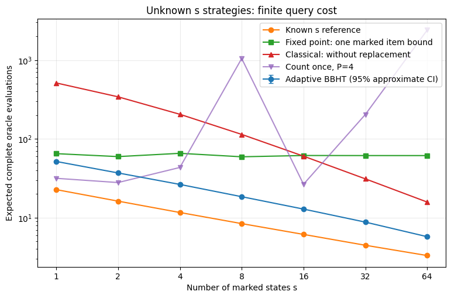

# Grover Search with an Unknown Number of Solutions

**Computational research | Five Jupyter notebooks | Ideal quantum query model**

Grover search can amplify the probability of measuring a marked item, but choosing the number of iterations normally depends on knowing how many items are marked. When that count is unknown, a poorly chosen stopping point can undo the amplification.

This project implements and compares established approaches to that problem, progressing from ordinary Grover search through sensitivity analysis, randomized iteration schedules, adaptive BBHT, quantum counting assisted search, and optimal fixed point amplitude amplification. The objective is to study the **information each method needs**, its **complete oracle query cost**, and the **reliability of its output**.

The repository is a finished **five notebook research snapshot**, not a claim of a new search algorithm or a demonstration of speedup on physical hardware.

## Research question

For an unsorted search space containing $N$ items, suppose an unknown number $s$ satisfies the marking predicate. How should a search strategy operate without knowing $s$, and what does it cost to find and verify a marked item?

The initial marked fraction is $a=s/N$. After $j$ standard Grover iterations,

$$
P(j;N,s)=\sin^2\!\left((2j+1)\arcsin\sqrt{s/N}\right).
$$

Because this probability oscillates, a stopping depth that works for one marked count may fail for another. The notebooks examine how randomization, adaptation, estimation, and fixed point sequences respond to this difficulty.

## Main numerical results

Notebook 05 compares the methods at $N=1024$ for $s\in\{1,2,4,8,16,32,64\}$. The table reports **mean complete oracle evaluations**, including candidate verification. Values are rounded from the notebook outputs.

| Marked items $s$ | Known $s$ reference | Adaptive BBHT | Optimal fixed point | Classical, without replacement |
| ---: | ---: | ---: | ---: | ---: |
| 1 | 22.675 | 51.632 | 64.893 | 512.500 |
| 2 | 16.197 | 36.923 | 59.519 | 341.667 |
| 4 | 11.619 | 26.399 | 65.520 | 205.000 |
| 8 | 8.398 | 18.439 | 59.197 | 113.889 |
| 16 | 6.125 | 12.836 | 61.463 | 60.294 |
| 32 | 4.460 | 8.773 | 61.353 | 31.061 |
| 64 | 3.302 | 5.731 | 61.317 | 15.769 |

**How to read this table:** The known $s$ method is an **oracle informed reference**, not an equal information competitor. The classical reference avoids repeated checks without needing $s$. Adaptive BBHT values are sample means from 3000 completed Monte Carlo trials for each $s$; the remaining columns are calculated using ideal analytical distributions.



*Figure: Saved output from Notebook 05. The logarithmic plot compares adaptive BBHT, the known $s$ reference, classical sampling without replacement, conservative fixed point search, and one specific counting assisted policy with its estimation budget fixed at $P=4$. Query counts are mathematical oracle costs, not device execution times.*

### What the results show

1. **An incorrect Grover depth can be destructive.** Notebooks 01 and 02 validate the oscillatory success probability and measure sensitivity to a mistaken value of $s$.
2. **Randomization and adaptation reduce dependence on a single depth.** Notebooks 03 and 04 validate the BBHT randomized success average and evaluate complete adaptive search runs.
3. **Estimating $s$ does not automatically make the whole search robust.** The specific policy studied in Notebook 05 counts once, chooses one Grover depth, and repeatedly restarts with that depth. Rare inaccurate estimates can give this policy a very large expected cost. For example, at $N=1024$ and $s=8$, its recorded means are approximately $1046.958$ for the preselected budget $P=4$ and $53.236$ for $P=32$. These are **two fixed policies**, not a budget chosen from the true count.
4. **Fixed point search trades a guarantee for a conservative cost.** With only the promise $s\geq1$ and a target failure probability of $0.1$, the Yoder, Low, and Chuang sequence has length $L=59$ and guarantees at least $90\%$ success per attempt across the promised range. Under the stated oracle model, it costs 58 Boolean oracle evaluations for the amplification sequence plus one verification evaluation per attempt.
5. **There is no universal winner established here.** Adaptive BBHT has lower observed mean cost than the conservative fixed point schedule for all seven tested counts, but the latter provides a uniform per attempt success guarantee. Different prior bounds, objectives, or accounting assumptions can change the tradeoff.

## Methods and information assumptions

| Method | Information available before search | Role |
| --- | --- | --- |
| Known $s$ restart | Exact marked count | Oracle informed performance reference |
| Classical sampling | $N$, not $s$ | Baselines with and without replacement |
| Adaptive BBHT | $N$, not $s$ | Randomized search with adaptive iteration window |
| Counting assisted search | $N$ and a predetermined estimation budget, not $s$ | One counting outcome selects a restart depth |
| Optimal fixed point search | A reliable lower bound on $s/N$ and a chosen failure tolerance | Predetermined Chebyshev phase sequence |

**Oracle accounting matters.** For BBHT, one standard Grover iteration is charged one phase marking query, realizable with one Boolean membership oracle evaluation by phase kickback, and each measured candidate is verified with one more evaluation. In the fixed point construction used here, a generalized target phase is implemented using two Boolean membership oracle evaluations. The chosen sequence therefore uses $L-1$ evaluations for amplification, then one for verification. The counting experiment charges its stipulated ideal $P$ oracle query units for the controlled counting stage before accounting for search and verification.

These conventions make the **ideal query comparison** explicit. They do not imply equivalent circuit depth, gate counts, hardware noise sensitivity, or physical execution time.

## Notebook guide

| Notebook | Purpose |
| --- | --- |
| [01: Standard Grover validation](notebooks/01_standard_grover_validation.ipynb) | Check the analytical success curve against Qiskit statevectors and show overshooting. |
| [02: Incorrect count sensitivity](notebooks/02_incorrect_s_sensitivity.ipynb) | Study how a wrong assumed marked count changes the selected stopping depth and success probability. |
| [03: Randomized iteration search](notebooks/03_randomized_iteration_search_analysis.ipynb) | Validate the BBHT average success formula and randomized iteration ranges. |
| [04: Adaptive BBHT](notebooks/04_adaptive_bbht_search.ipynb) | Implement complete adaptive searches, estimate query costs and tails, and test growth factors. |
| [05: Strategy comparison](notebooks/05_unknown_s_strategy_comparison.ipynb) | Compare known $s$, classical search, adaptive BBHT, the specified counting policy, and optimal fixed point search. |

Notebook 05 in `notebooks/` contains the completed strategy comparison.

## Reproduce the study

The notebooks contain saved code outputs and figures for inspection on GitHub. With a Python environment **already activated**, install the listed dependencies and open Jupyter:

```bash
git clone https://github.com/ManasviK24/grover-search-unknown-solutions.git
cd grover-search-unknown-solutions
python -m pip install -r requirements.txt
jupyter lab
```

For instructions on creating and activating a fresh virtual environment on Windows, Linux, or macOS, see [REPRODUCIBILITY.md](REPRODUCIBILITY.md). Run the notebooks in numerical order. The first three use Qiskit statevector tools, while Notebooks 04 and 05 mainly use NumPy, Pandas, and analytical probability models.

**Environment provenance:** Metadata in Notebooks 01 through 04 records Python 3.12.0; Notebook 05 records Python 3.13.5. The original executions did **not** capture exact installed package versions. Accordingly, [requirements.txt](requirements.txt) lists dependencies but is **not a historical lockfile**. To document your own rerun, record `python --version` and `python -m pip freeze`. See [REPRODUCIBILITY.md](REPRODUCIBILITY.md) for details and limitations.

## Research scope and references

The principal comparison has $N=1024$, seven marked counts, deterministic seeds for the BBHT runs, and ideal quantum operations. Fixed point phase construction is checked against the analytical Chebyshev success expression using an independent two dimensional matrix implementation. These experiments do **not** establish noisy hardware performance or asymptotic advantage from measured devices.

See [REFERENCES.md](REFERENCES.md) for the original papers by Grover, Boyer, Brassard, Høyer, Tapp, Yoder, Low, Chuang, and others.

## Project status and reuse

**Status:** Five completed notebooks published as a finite instance research snapshot. Alternative counting policies, additional prior bounds, circuit compilation, and noise studies are possible later extensions, not prerequisites for sharing the present results.

**License:** No license has been selected. Public access to the repository does not, by itself, grant reuse permissions.
