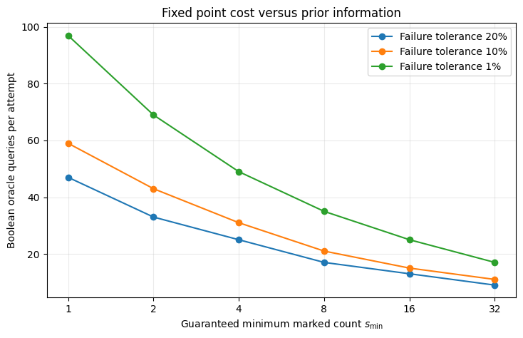

<div align="center">

# Grover Search with an Unknown Number of Solutions

**How should quantum search proceed when the number of marked states is unknown?**

A numerical investigation of Grover amplification, randomized stopping times, adaptive BBHT, quantum counting, and optimal fixed point search.

<p>
  
  
  
  
</p>

[**Results**](#results-at-a-glance) &nbsp;·&nbsp; [**Notebooks**](#notebook-roadmap) &nbsp;·&nbsp; [**Methodology**](#methodology-and-fairness) &nbsp;·&nbsp; [**Reproduce**](#run-the-notebooks) &nbsp;·&nbsp; [**References**](REFERENCES.md)

</div>

## The problem

Grover's algorithm amplifies the probability of finding a marked item in an unstructured search space. But its optimal stopping time depends on the number of marked items. When that count is unknown, too many iterations can reduce the probability of success instead of improving it.

For a database of size $N$ containing $s$ marked elements, the success probability after $j$ ordinary Grover iterations is

$$
P(j;N,s)=\sin^2\!\left((2j+1)\arcsin\sqrt{s/N}\right).
$$

This project asks how different search strategies respond to that uncertainty, and how they compare when **prior information, success guarantees, and the cost of verification** are accounted for explicitly.

## Results at a glance

The primary comparison uses **$N=1024$**, with **$s\in\{1,2,4,8,16,32,64\}$**. Adaptive BBHT uses 3000 completed Monte Carlo trials per marked count. The other columns below are calculated from ideal analytical distributions.

<p align="center">
  
</p>

<p align="center"><sub>Figure 1. Expected complete query cost for the tested strategies. The figure also includes one particular counting assisted policy with a fixed budget of P = 4. Axes are logarithmic.</sub></p>

### Mean complete oracle evaluations

| Marked items $s$ | Known $s$ reference¹ | Adaptive BBHT | Fixed point² | Classical sampling³ |
| ---: | ---: | ---: | ---: | ---: |
| 1 | 22.675 | **51.632** | 64.893 | 512.500 |
| 2 | 16.197 | **36.923** | 59.519 | 341.667 |
| 4 | 11.619 | **26.399** | 65.520 | 205.000 |
| 8 | 8.398 | **18.439** | 59.197 | 113.889 |
| 16 | 6.125 | **12.836** | 61.463 | 60.294 |
| 32 | 4.460 | **8.773** | 61.353 | 31.061 |
| 64 | 3.302 | **5.731** | 61.317 | 15.769 |

<sub>¹ This reference knows the true marked count and is not an equal information competitor. ² Yoder, Low, and Chuang search with the conservative promise $s\ge 1$ and a failure tolerance of $0.1$. ³ Uniform classical search without replacement. Each value includes candidate verification according to the model specified in Notebook 05.</sub>

### What stands out

**Adaptation is efficient in the tested regime.** BBHT has a lower observed mean complete query cost than the conservative fixed point schedule at all seven tested marked counts. This is a finite instance finding, not a universal performance ordering.

**A guarantee and a low expected cost are different goals.** The chosen fixed point sequence guarantees at least **90% success per attempt** whenever $s\ge 1$. Its sequence length is $L=59$, with **58 Boolean oracle evaluations for amplification and one for verification** per attempt.

**Counting accuracy does not automatically imply a robust search policy.** In the concrete policy evaluated here, one count estimate selects a Grover depth that is then reused after every failed search. Rare inaccurate estimates can select almost destructive depths. For $N=1024$ and $s=8$, this policy has calculated mean costs of approximately **1046.958** queries with a predetermined counting budget $P=4$, versus **53.236** with $P=32$. These results apply to that specified policy, not to all counting assisted algorithms.

## Notebook roadmap

The notebooks form a progressive investigation. Each contains its mathematical setup, implementation, numerical checks, and interpretation.

| Stage | Open notebook | Question investigated |
| :---: | --- | --- |
| **01** | [Standard Grover validation](notebooks/01_standard_grover_validation.ipynb) | Do statevector probabilities agree with the analytical amplification curve? |
| **02** | [Sensitivity to an incorrect solution count](notebooks/02_incorrect_s_sensitivity.ipynb) | What happens when the stopping time is chosen using an incorrect $s$? |
| **03** | [Randomized Grover iterations](notebooks/03_randomized_iteration_search_analysis.ipynb) | Can randomizing the iteration count reduce dependence on a single stopping depth? |
| **04** | [Adaptive BBHT search](notebooks/04_adaptive_bbht_search.ipynb) | How does an adaptive randomization window perform without knowing $s$? |
| **05** | [Strategy comparison](notebooks/05_unknown_s_strategy_comparison.ipynb) | How do classical baselines, BBHT, quantum counting, and fixed point search compare on the same finite problems? |

**Recommended reading:** Start with [Notebook 01](notebooks/01_standard_grover_validation.ipynb) to follow the full derivation, or open [Notebook 05](notebooks/05_unknown_s_strategy_comparison.ipynb) for the integrated comparison.

## Methodology and fairness

The algorithms are not assigned identical information. Their assumptions are part of the comparison rather than hidden implementation details.

| Strategy | Information available before search | Purpose |
| --- | --- | --- |
| Known $s$ restart | Exact $s$ | Oracle informed reference |
| Classical sampling | $N$, not $s$ | Reference with and without replacement |
| Adaptive BBHT | $N$, not $s$ | Randomized search with adaptive range growth |
| Counting assisted search | $N$ and a fixed counting budget, not $s$ | Estimate once, select a depth, then restart |
| Optimal fixed point search | A lower bound on $s/N$ and a target failure tolerance | Robust Chebyshev amplification sequence |

**Query accounting.** A standard Grover phase marking is charged one Boolean membership oracle evaluation, and checking a measured candidate costs one more. In the fixed point implementation, a generalized target reflection uses two Boolean oracle evaluations. Thus the $L=59$ fixed point schedule costs 58 evaluations for amplification, followed by one verification evaluation. The counting assisted experiment also charges the oracle evaluations assigned to its counting stage.

The primary metric is **complete oracle queries to obtain and verify a marked result**, not just Grover iterations. These are ideal mathematical oracle costs. They do not imply equivalent physical circuit depth or hardware execution time.

<details>
<summary><strong>Explore the effect of stronger fixed point promises</strong></summary>

<br>

If an application reliably promises more than one marked state, the fixed point sequence can be shorter. Notebook 05 examines several supplied lower bounds and failure tolerances. It does **not** choose a bound using the hidden true $s$.

<p align="center">
  
</p>

<p align="center"><sub>Figure 2. Oracle queries per fixed point attempt for different prior lower bounds and target failure tolerances. Saved output from Notebook 05.</sub></p>

</details>

## Run the notebooks

The repository contains executed notebooks with saved numerical tables and figures, which can be viewed directly on GitHub.

In an activated Python environment, run:

```bash
git clone https://github.com/ManasviK24/grover-search-unknown-solutions.git
cd grover-search-unknown-solutions
python -m pip install -r requirements.txt
jupyter lab
```

The first three notebooks use Qiskit statevector simulations. Notebooks 04 and 05 primarily use analytical probability expressions and NumPy based numerical experiments.

**Environment note:** Notebook metadata records Python 3.12.0 for Notebooks 01 through 04 and Python 3.13.5 for Notebook 05. The original installed dependency versions were not fully captured, so `requirements.txt` is a dependency list, **not** an exact historical lockfile. Consult [REPRODUCIBILITY.md](REPRODUCIBILITY.md) for environment setup, numerical checks, and limitations.

## Sources, scope, and status

The analysis draws on Grover's original algorithm, the BBHT unknown solution count method, quantum counting and amplitude amplification, and Yoder, Low, and Chuang's optimal fixed point construction. The original research papers are linked in [REFERENCES.md](REFERENCES.md).

> [!NOTE]
> **Scientific scope:** These notebooks investigate ideal oracle models and finite numerical instances. They do not demonstrate quantum advantage on physical hardware, model noisy devices, or establish a new quantum search algorithm.

**Current status:** Five completed notebooks constitute a public research snapshot. Broader search regimes, alternative counting policies, circuit compilation, and noise studies can be added independently later.

**Reuse:** No license has been selected. Public visibility alone does not grant reuse permissions.
